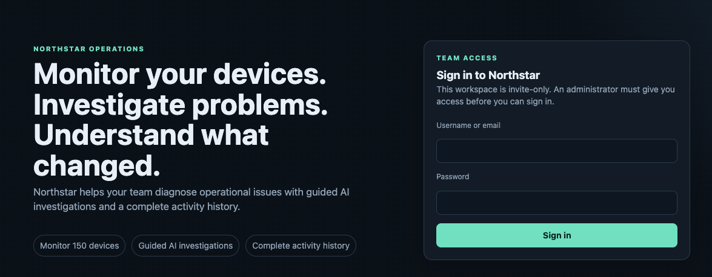
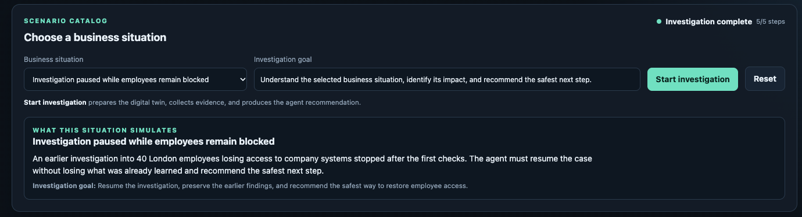
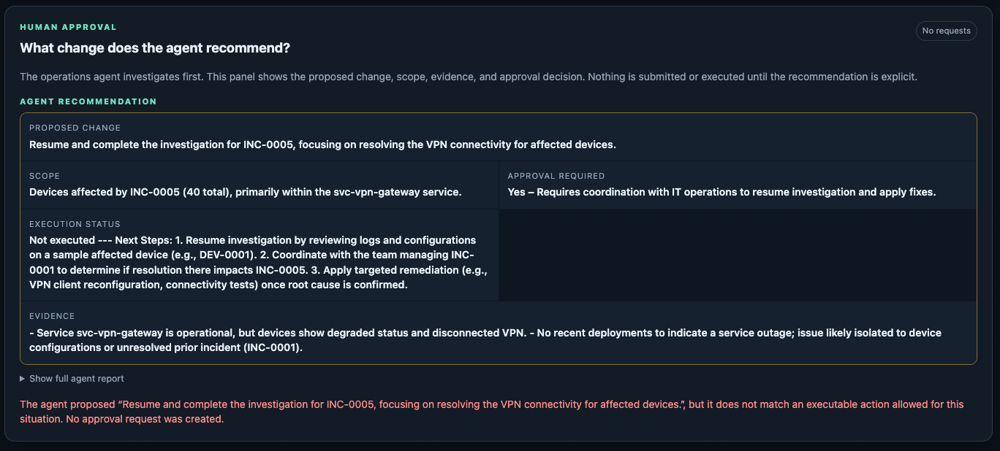
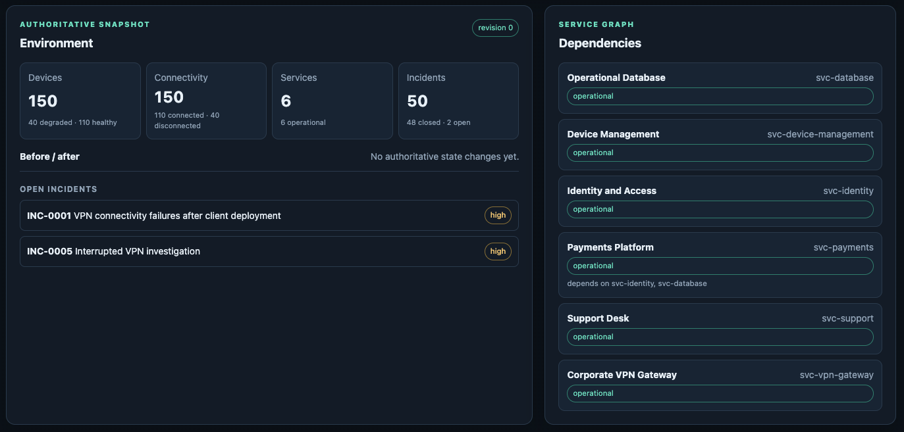
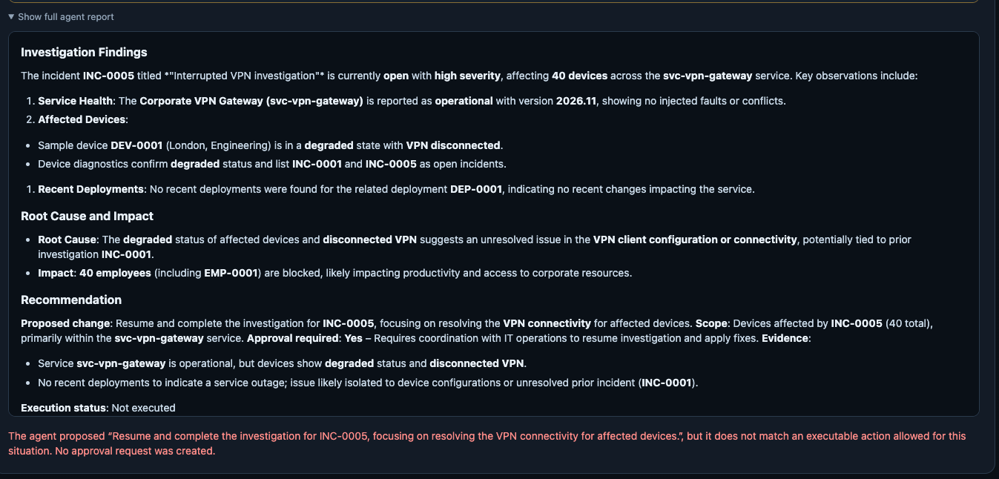
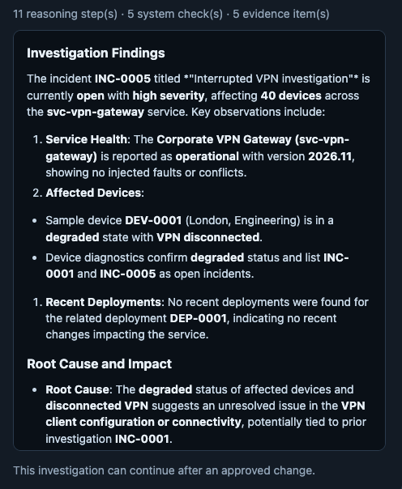

# Northstar IT Operations

This case study and its implementation were created with substantial
assistance from AI. AI generated much of the code and helped develop the
accompanying materials, while I directed the architecture, made the design
decisions, and reviewed the results. This project is intended as a tutorial.

## Overview

Northstar represents the internal IT operations and service-management team of
an enterprise. That team supports employees and business departments by
keeping company devices, access, business applications, and shared services
working.

Northstar is a web application for demonstrating how an AI operations agent
works through one of that team's incidents from investigation to verified
resolution.

The system gives the agent an incident and access to connected records from a
fictional company. The agent gathers evidence with tools, explains what it
found, recommends the next action, pauses for human approval when a change is
required, performs the approved change, and verifies the resulting state.

The web console makes the process visible in real time: users can follow the
agent's tool calls, observations, decisions, approvals, changes, recovery
steps, and final evaluation. The goal is to show a controlled agent workflow,
not simply generate a text answer.

All company data and infrastructure are simulated. Northstar is a safe test
environment for exploring Amazon Bedrock AgentCore Harness concepts such as
tool use, durable runs, approval gates, recovery, and independent evaluation;
it does not change real infrastructure.

## Features

- Choose from concrete workplace situations, such as employees losing access
  after a software update, Finance and Sales being unable to use the payments
  portal, or an employee requesting temporary access to a restricted system.
- Read a plain-language explanation of who is affected, what is blocked, and
  what decision the agent must make before starting an investigation.
- Let the agent investigate using read-only tools against the digital twin.
- Watch tool calls, observations, decisions, and run state in the React console.
- Require approval before the agent performs a synthetic remediation.
- Verify the result with an independent evaluator.
- Store runs and event history in DynamoDB and monitor them with polling.
- Run the console from a Lambda Function URL with Cognito authentication; only
  administrators can invite users.
- Let Cognito administrators edit Bedrock Prompt Management drafts, preview
  rendered prompts, create immutable versions, and select the version used by
  future investigations.
- Exercise AgentCore Harness behavior including checkpoints, compaction,
  recovery, and fault handling.

## Deployment

See [DEPLOYMENT.md](DEPLOYMENT.md) for the manifest-driven deployment pattern,
prerequisites, stack-only retries, prompt version updates, and verification
commands.

## Screenshots and walkthrough

The following walkthrough follows an investigation of **INC-0005 — Interrupted
VPN investigation**, which affects 40 London employees and their devices. The screenshots
show the console's main path from access and scenario selection through agent
reasoning, evidence, recommendation, and replayable history.

### 1. Sign in

Northstar is invite-only. An administrator must give each user access before
they can sign in.

### 2. Choose a business situation

Select a scenario and review its description and investigation goal before
starting. The console explains what the situation simulates, who is affected,
and what the agent needs to determine.

### 3. Review the agent's recommendation

After the agent investigates, the human-approval panel summarizes the proposed
change, scope, approval requirement, execution status, and evidence. In this
example, the recommendation does not match an executable action allowed for
the scenario, so Northstar fails closed and creates no approval request.

### 4. Inspect authoritative state

The environment view gives the team a current snapshot: device count and
health, connectivity, services, and open incidents. The service graph shows
dependencies so the investigation can separate service-wide failures from
device-level issues.

### 5. Read the agent's findings

The expanded report records the evidence and reasoning behind the
recommendation, including service health, affected devices, recent
deployments, root cause, and impact. The findings view keeps the report
available for review after the run completes.

### 6. Inspect affected devices

The fleet view makes the scope concrete by listing devices, offices, health,
and connectivity state. Here, the affected London devices are degraded and
disconnected from VPN.

### 7. Follow investigation progress

The live progress card shows the run's lifecycle: run created, agent planning,
evidence collection, recommendation building, and ready for review. The latest
activity makes the current stage easy to scan.

### 8. Replay what happened

The execution timeline preserves the run as ordered events—scenario creation,
agent invocation, reasoning passes, tool calls, observations, and subsequent
decisions. This makes the investigation auditable and replayable rather than
just a final answer.

## AgentCore services

| Service or feature | How Northstar uses it |
| --- | --- |
| AgentCore Harness | Runs the model-driven agent loop: tool selection, iteration, managed memory, and streamed results. |
| AgentCore Gateway | Exposes six read-only synthetic IT operations backed by the simulator Lambda. |
| AgentCore Memory | Provides managed Harness continuity; DynamoDB remains the authoritative business state. |
| Harness Skills | Supplies versioned diagnostic, triage, remediation-safety, and verification guidance from S3. |
| AgentCore Runtime | Not used; the API and React console run in Lambda behind a Function URL. |
| AgentCore Identity | Not used; Cognito handles user authentication and administrator membership. |
| AgentCore Policy | Not used as a separate service; application authorization and a Harness lifecycle hook enforce the safety boundary. |
| AgentCore Observability | Not separately provisioned; the application records normalized run events in DynamoDB and logs. |
| AgentCore Evaluations | Not used; the repository’s independent evaluator scores the deterministic simulator state and expected outcomes. |
| Bedrock Prompt Management | Supporting service used to store, version, preview, and activate the prompts sent to Harness. |
