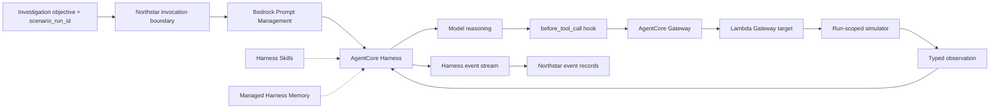
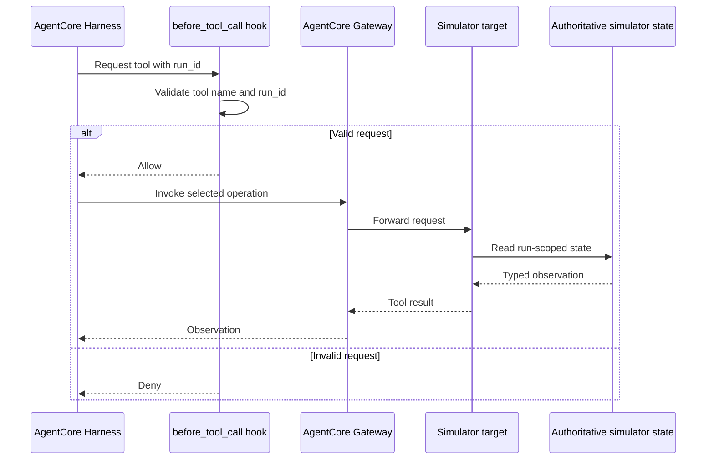

# Using Amazon Bedrock AgentCore in Northstar

Northstar is a synthetic IT operations environment that demonstrates how an AI agent can investigate operational incidents, gather evidence, and recommend a course of action.

The demo uses Amazon Bedrock AgentCore to manage these investigations. An agent can inspect service health, retrieve incident details, examine device diagnostics, review recent deployments, and search operational guidance through a set of read-only tools. It uses the evidence it collects to produce a business-facing recommendation.

Northstar remains responsible for the underlying simulator state, approvals, and any state-changing operations. The agent can investigate and recommend actions, but it cannot directly modify the environment through its investigation tools.

This tutorial explains how Northstar uses AgentCore, from starting an investigation and calling tools to managing context, enforcing safety boundaries, and evaluating the result.

## 1. How an investigation works

Consider a scenario where employees are unable to access a business-critical service.

Northstar creates an isolated scenario run and sends the investigation objective to AgentCore Harness. Harness then manages the investigation.

The agent might begin by retrieving the incident record, then check service health, examine affected devices, or review recent deployments. Each tool call returns an observation that helps the agent decide what to investigate next.

This continues until the agent has enough evidence to produce a recommendation or reaches a configured execution limit.

Northstar records the investigation as it happens, including tool calls, observations, and the final report. If the recommendation involves changing simulator state, the application handles approval and execution separately. Harness can then be invoked again to verify the result.

The key architectural distinction is that **AgentCore Harness manages reasoning, tool selection, and iteration, while Northstar provides the tools, authoritative state, and application controls.**

### Where AgentCore fits

Northstar uses several AgentCore capabilities to support this workflow:

| Capability                  | Role in Northstar                                                                                   |
| --------------------------- | --------------------------------------------------------------------------------------------------- |
| **AgentCore Harness**       | Manages model reasoning, tool selection, iteration, and stopping conditions.                        |
| **AgentCore Gateway**       | Exposes six read-only simulator operations as tools the agent can call.                             |
| **Harness lifecycle hooks** | Validate tool calls before execution and reject requests outside the allowed boundary.              |
| **Harness Skills**          | Provide reusable guidance for incident triage, diagnostics, remediation planning, and verification. |
| **Harness managed memory**  | Maintains useful context through summarization and episodic memory.                                 |

Northstar also uses Amazon Bedrock Prompt Management to maintain versioned instructions for investigations, approval resumption, and evaluation.

### End-to-end architecture



The important part of this flow is what happens after a tool returns an observation. That observation goes back to Harness, which decides whether another tool call is needed.

Northstar does not orchestrate those subsequent model and tool interactions. It starts the managed invocation and records the resulting events.

## 2. Starting an investigation with Harness

An investigation begins at the Northstar invocation boundary.

The application prepares the context, resolves the selected prompt, and submits a single request to the managed Harness API.

The process has five steps:

1. Create an `InvocationContext` containing the scenario run ID, session ID, request ID, and trace ID.
2. Resolve the selected Prompt Management version and render its runtime variables.
3. Start the investigation using `invoke_harness`.
4. Process the returned event stream into structured model output, tool-use records, usage metrics, stop reasons, and errors.
5. Persist the lifecycle events and return the investigation result.

Two files implement this boundary:

- [`harness/api.py`](harness/api.py) prepares the invocation context, resolves prompts, invokes Harness, and records events.
- [`harness/agentcore.py`](harness/agentcore.py) provides the boto3 adapter for the managed `invoke_harness` data-plane API and normalizes its event stream.

The adapter processes the events returned by Harness. It does not select tools, dispatch them, or call the model again after receiving a tool result.

For example, the application does not contain an orchestration loop like this:

```text
while not finished:
    response = model(...)
    tool = choose_tool(response)
    result = call_tool(tool)
    messages.append(result)
```

Harness manages that loop internally.

Northstar can calculate values such as `turn_count` from the event stream for reporting, but those calculations do not control the investigation.

### Configuring Harness

The Harness configuration is defined in [`harness/config/northstar-harness.yaml`](harness/config/northstar-harness.yaml).

It specifies the model, available tools, operating guidance, memory strategies, and execution limits.

| Setting               | Northstar configuration                                                     |
| --------------------- | --------------------------------------------------------------------------- |
| Model                 | Bedrock model selected through `HARNESS_MODEL_ID`                           |
| System prompt         | Evidence-first investigation instructions and a fixed recommendation format |
| Gateway tool source   | `northstar-simulator`                                                       |
| Allowed tool selector | `@northstar-simulator`                                                      |
| Skills                | Four versioned packages under `harness/skills`                              |
| Memory                | `SUMMARIZATION` and `EPISODIC`                                              |
| Memory expiry         | Seven days                                                                  |
| Maximum iterations    | 12                                                                          |
| Maximum output tokens | 4,096                                                                       |
| Execution time limit  | 180 seconds                                                                 |

These limits are enforced through Harness configuration rather than an application-managed retry or iteration loop.

The agent can finish earlier when it has sufficient evidence. Otherwise, Harness stops the investigation when a configured limit is reached.

## 3. Connecting Harness to the simulator through Gateway

Harness needs access to operational information to investigate an incident.

Northstar provides that access through an AgentCore Gateway target named `northstar-simulator`.

The Gateway exposes six read-only operations backed by the synthetic simulator.

| Operation                 | Information returned                                            |
| ------------------------- | --------------------------------------------------------------- |
| `check_service_health`    | Service health and affected dependencies                        |
| `get_device_diagnostics`  | Diagnostics for a device associated with the incident           |
| `get_incident`            | Incident status, impact, timeline, and known evidence           |
| `find_affected_devices`   | Devices or users within the affected scope                      |
| `list_recent_deployments` | Recent changes that may be related to the incident              |
| `search_knowledge`        | Relevant guidance from the synthetic operational knowledge base |

The tool definitions are maintained in [`harness/gateway/northstar-tools.openapi.json`](harness/gateway/northstar-tools.openapi.json).

Harness sees these operations using Gateway-qualified tool names, such as:

```text
northstar-simulator___check_service_health
northstar-simulator___get_incident
```

The `@northstar-simulator` selector makes this Gateway target available to Harness.

When the agent selects a tool, Gateway routes the request to the Lambda target, which performs the corresponding read operation against the run-scoped simulator.

The target implementation is in [`apps/api/gateway_handler.py`](apps/api/gateway_handler.py).

### What happens during a tool call



The agent receives structured observations rather than direct access to the simulator's underlying state store.

This gives Harness the information it needs to reason about the incident without exposing arbitrary simulator operations.

Gateway also provides a clear integration boundary. The agent selects a tool based on its description and available context, while the Gateway target determines how that operation is executed.

Making a tool available through Gateway does not automatically authorize every call. Northstar validates requests before they reach the simulator.

## 4. Keeping investigations read-only

Northstar separates investigation from execution.

During an investigation, Harness can retrieve evidence and recommend actions. It cannot use its Gateway tools to modify simulator state.

This boundary is enforced through the available Gateway operations, a Harness lifecycle hook, and validation in the simulator backend.

### Validating tool calls with a lifecycle hook

The lifecycle hook is implemented in [`apps/api/hook_handler.py`](apps/api/hook_handler.py).

It runs at the `before_tool_call` stage and checks two things:

1. The requested tool is one of the six permitted read-only Gateway operations.
2. The tool input contains a non-empty `run_id`.

If either check fails, the hook rejects the call.

Harness has already selected the tool at this point. The hook does not decide whether the tool is useful for the investigation. Its responsibility is to determine whether the requested call satisfies Northstar's tool-use contract.

The Gateway target also validates the run-scoped request before accessing simulator state.

### Handling state-changing recommendations

An investigation may conclude that an operational change is necessary.

For example, the agent might recommend a bounded remediation to restore service. It can explain the proposed action, supporting evidence, and expected outcome, but it cannot execute that change through the read-only Gateway target.

Instead, the application handles the approval and execution process.

Once an approved synthetic change has been applied, Northstar can start or resume a Harness invocation to verify the result using the same read-only tools.

This keeps the responsibilities separate:

- **Harness** investigates, reasons, recommends, and verifies.
- **The application** manages approval and state-changing actions.
- **The simulator** maintains authoritative operational state.

A recommendation is therefore not treated as evidence that a change has already occurred.

## 5. Providing guidance and context

Harness needs more than tools to carry out a useful investigation. It also needs instructions about how to interpret evidence, handle uncertainty, and structure recommendations.

Northstar provides this context through Harness Skills, managed memory, and Bedrock Prompt Management.

These mechanisms serve different purposes. Skills provide reusable domain guidance, memory preserves relevant context, and prompts define the objective and instructions for a particular invocation.

### Harness Skills

Northstar attaches four versioned skill packages:

| Skill                      | Purpose                                                                     |
| -------------------------- | --------------------------------------------------------------------------- |
| `vpn-diagnostics`          | Guides connectivity troubleshooting and device diagnostics                  |
| `incident-triage`          | Structures evidence collection, impact assessment, and uncertainty handling |
| `safe-remediation`         | Guides the description of bounded changes that require approval             |
| `post-change-verification` | Guides verification after an approved change                                |

The packages are stored under `harness/skills`.

Skills help the agent approach operational problems consistently. For example, an incident-triage skill can guide the agent to establish impact and gather supporting evidence before reaching a conclusion.

A post-change-verification skill can guide the agent to check actual simulator state rather than assuming that a remediation succeeded.

Skills do not expand the agent's permissions. They cannot add Gateway operations, bypass lifecycle hooks, or authorize state changes.

### Managed Harness memory

Northstar enables two managed memory strategies:

- `SUMMARIZATION` compresses longer interaction histories into useful context.
- `EPISODIC` retains relevant context from previous interactions.

The demo configures a seven-day expiry for memory events.

Memory helps Harness maintain continuity, particularly when an investigation spans multiple interactions or resumes after an approval step.

However, remembered context is not authoritative evidence about the current environment.

For example, memory might contain a previous observation indicating that a service was unhealthy. That observation can help the agent understand the investigation history, but it does not establish the service's current condition.

The simulator remains the source of truth for service health, incidents, devices, deployments, approved changes, and verification results.

When the agent needs to establish current operational state, it must use the available tools to retrieve evidence.

### Bedrock Prompt Management

Northstar uses Amazon Bedrock Prompt Management to maintain versioned prompt definitions.

The demo has three prompt types:

| Prompt                | Purpose                                                                                                 |
| --------------------- | ------------------------------------------------------------------------------------------------------- |
| `investigation`       | Starts an evidence-first, read-only investigation                                                       |
| `approval_resumption` | Restores context after an application-owned approved operation and directs Harness to verify the result |
| `evaluation`          | Provides consistent instructions for bounded evaluation runs                                            |

Prompt resolution is implemented in [`harness/prompt_management.py`](harness/prompt_management.py).

When the managed prompt source is enabled, Northstar resolves the selected immutable prompt version and substitutes runtime variables such as `scenario_run_id`.

The rendered prompt is then passed to the Harness adapter.

Northstar also records prompt metadata, including the prompt key, version, ARN, and source, in its runtime events. This makes it possible to identify which instructions were used for an investigation without copying the complete prompt body into every event.

Prompt Management controls the instructions supplied to Harness. It does not replace Harness orchestration or change the agent's tool permissions.

## 6. Recording and evaluating investigations

Northstar records the events produced by Harness so that an investigation can be inspected and evaluated after it completes.

The event stream provides information about what happened during execution, including tool usage, observations, model output, token usage, latency, stop reasons, and errors.

These records are useful for understanding how the agent reached its recommendation.

However, evaluating an investigation requires more than reading the final report.

An agent might produce a convincing explanation while missing an important observation, or describe a remediation as completed when no state change occurred.

Northstar addresses this by evaluating investigations against simulator evidence and durable execution records.

### Keeping the simulator repeatable

The demo uses a seeded, run-scoped simulator.

Each scenario has controlled initial conditions, tool behavior, and synthetic state transitions. Scenario definitions and expected outcomes are versioned.

This provides a repeatable environment for evaluating investigations.

The agent itself remains model-driven, so some aspects of execution can vary between runs:

- Which relevant tool it selects first
- How many turns it needs to gather evidence
- How it phrases its recommendation
- How much time and token usage the investigation requires

The distinction is that **the simulator and evaluator are deterministic, while the Harness investigation is model-driven.**

The evaluator can therefore assess whether the agent obtained the required evidence and respected the execution boundaries without requiring every investigation to follow exactly the same sequence of tool calls.

### Independent evaluation

The evaluator is implemented in [`evaluation/runner.py`](evaluation/runner.py).

It runs outside the Harness invocation and evaluates the investigation using:

- Authoritative simulator state
- Durable lifecycle events
- Typed tool observations
- Versioned expected outcomes
- Usage and latency information

The evaluator checks whether the agent gathered the required evidence, stayed within the read-only boundary, handled recovery and checkpoint conditions, and produced a recommendation consistent with the observed state.

It also checks that the agent does not claim an unexecuted change was completed.

This evaluation is based on structured evidence rather than relying solely on the model's final prose.

The evaluator does not run a separate model-driven investigation or implement another agent loop.

## 7. Following an investigation from start to finish

The complete workflow can be illustrated with a service outage scenario.

Suppose employees report that a business application is unavailable.

**Step 1: Northstar creates the scenario run**

The application creates an isolated `scenario_run_id` and prepares the invocation context.

It resolves the selected investigation prompt and sends the objective to AgentCore Harness.

**Step 2: Harness begins investigating**

Harness interprets the objective and selects an appropriate read-only tool.

It might start with `get_incident` to understand the reported impact or `check_service_health` to inspect the affected service.

**Step 3: The tool call is validated**

Before execution, the lifecycle hook checks the requested tool name and confirms that the input includes a run ID.

A valid call proceeds to Gateway. An invalid call is rejected.

**Step 4: Gateway retrieves simulator evidence**

Gateway invokes the Lambda target, which reads the corresponding run-scoped simulator state.

The simulator returns a typed observation, such as incident details or service-health information.

**Step 5: Harness decides what to investigate next**

Harness receives the observation and uses it to decide whether additional evidence is needed.

For example, if the service-health result indicates a dependency problem, Harness might inspect affected devices or review recent deployments.

Northstar does not select these follow-up tools.

**Step 6: Harness produces a recommendation**

Once the agent has sufficient evidence, or reaches a configured execution bound, Harness ends the investigation.

The final report follows the configured recommendation format and explains the findings using the available evidence.

**Step 7: Northstar records and evaluates the result**

The application persists the event stream and makes the investigation report available.

The independent evaluator checks the recorded observations and authoritative simulator state against the scenario's expected outcomes.

**Step 8: An approved change can be verified**

If the recommendation requires a state-changing operation, the application handles approval and execution outside the read-only Gateway contract.

A subsequent Harness invocation can retrieve fresh simulator evidence to verify whether the approved change had the intended effect.

This workflow demonstrates the division of responsibility: Harness performs the investigation, Gateway provides controlled access to evidence, and Northstar manages state, approval, and evaluation.

## 8. Understanding the component boundaries

The architecture deliberately separates agent orchestration from application responsibilities.

| Component                     | Responsibility                                                                                        |
| ----------------------------- | ----------------------------------------------------------------------------------------------------- |
| **AgentCore Harness**         | Model reasoning, tool selection, iteration, stopping conditions, and event streaming                  |
| **AgentCore Gateway**         | Exposing and routing bounded simulator operations                                                     |
| **Lifecycle hook**            | Validating tool calls before execution                                                                |
| **Harness Skills**            | Providing reusable investigation guidance                                                             |
| **Harness managed memory**    | Maintaining relevant interaction context                                                              |
| **Bedrock Prompt Management** | Storing and resolving versioned invocation instructions                                               |
| **Northstar application**     | Creating runs, invoking Harness, recording events, managing approvals, and executing approved changes |
| **Northstar simulator**       | Maintaining authoritative synthetic operational state                                                 |
| **Northstar evaluator**       | Checking results against structured evidence and expected outcomes                                    |

This separation is also why the demo does not need to implement its own model/tool/model orchestration loop.

Harness owns the investigation process. Northstar supplies the surrounding environment and application controls.

### AgentCore capabilities outside this demo

Northstar focuses on the AgentCore capabilities directly involved in its investigation workflow.

Several other AgentCore services are not configured as separate components:

| Capability                  | How it relates to Northstar                                                                                                                                |
| --------------------------- | ---------------------------------------------------------------------------------------------------------------------------------------------------------- |
| **AgentCore Runtime**       | Northstar invokes the managed Harness directly rather than using Runtime as a separate application component.                                              |
| **AgentCore Identity**      | The demo uses its application identity boundary and IAM-controlled service calls rather than AgentCore Identity for tool authorization.                    |
| **AgentCore Policy**        | Tool restrictions are enforced through the Gateway allow-list, lifecycle hook, backend validation, and IAM rather than a separate AgentCore Policy engine. |
| **AgentCore Observability** | Northstar records normalized Harness events and run records directly instead of relying on a separate AgentCore Observability workflow.                    |
| **AgentCore Evaluations**   | Evaluation is implemented in repository code against deterministic simulator evidence rather than through the separate AgentCore Evaluations service.      |

These choices keep the demo focused on how Harness, Gateway, Skills, Memory, and lifecycle hooks work together during an investigation.

They do not imply that the omitted services are unnecessary for other AgentCore applications.

## 9. Exploring the implementation

The following files provide the main entry points for understanding the integration.

| File                                                                                           | What it implements                                                             |
| ---------------------------------------------------------------------------------------------- | ------------------------------------------------------------------------------ |
| [`harness/api.py`](harness/api.py)                                                             | Invocation context, prompt resolution, Harness invocation, and event recording |
| [`harness/agentcore.py`](harness/agentcore.py)                                                 | `invoke_harness` adapter and event normalization                               |
| [`harness/config/northstar-harness.yaml`](harness/config/northstar-harness.yaml)               | Harness model, Gateway, Skills, Memory, and execution limits                   |
| [`harness/gateway/northstar-tools.openapi.json`](harness/gateway/northstar-tools.openapi.json) | Read-only Gateway tool definitions                                             |
| [`apps/api/gateway_handler.py`](apps/api/gateway_handler.py)                                   | Gateway target dispatch to simulator read operations                           |
| [`apps/api/hook_handler.py`](apps/api/hook_handler.py)                                         | `before_tool_call` validation                                                  |
| [`harness/prompt_management.py`](harness/prompt_management.py)                                 | Prompt version resolution and variable rendering                               |
| [`evaluation/runner.py`](evaluation/runner.py)                                                 | Independent evidence-based evaluation                                          |

A useful way to explore the code is to follow the same path as an investigation:

1. Start with `harness/api.py` to see how Northstar prepares and starts an invocation.
2. Open `harness/agentcore.py` to see how the application calls Harness and processes its event stream.
3. Review `northstar-harness.yaml` to understand the configured model, tools, memory, skills, and execution limits.
4. Examine the Gateway OpenAPI contract and target handler to see how the agent retrieves simulator evidence.
5. Review the lifecycle hook to understand the read-only tool boundary.
6. Finish with `evaluation/runner.py` to see how the investigation is assessed independently of the model's final report.

## Conclusion

Northstar demonstrates how Amazon Bedrock AgentCore can manage an agent-driven operational investigation without requiring the application to implement its own reasoning and tool-use loop.

Harness manages the investigation, selects tools, processes observations, and determines when to stop. Gateway connects those tool calls to a bounded simulator, while lifecycle hooks and backend validation enforce the read-only boundary.

Skills, managed memory, and versioned prompts provide the context the agent needs to investigate consistently.

Northstar remains responsible for authoritative state, approvals, durable records, and evaluation. This allows the agent to investigate and recommend actions while keeping operational changes under application control.

The result is an architecture where the agent's reasoning can remain flexible, but its access to the environment and the evidence used to evaluate its work are explicitly controlled.

## References

- [Amazon Bedrock AgentCore Harness](https://docs.aws.amazon.com/bedrock-agentcore/latest/devguide/harness.html)
- [Get started with AgentCore Harness](https://docs.aws.amazon.com/bedrock-agentcore/latest/devguide/harness-get-started.html)
- [Use tools with AgentCore Harness](https://docs.aws.amazon.com/bedrock-agentcore/latest/devguide/harness-tools.html)
- [Add a Lambda target to AgentCore Gateway](https://docs.aws.amazon.com/bedrock-agentcore/latest/devguide/gateway-add-target-lambda.html)
- [Use memory with AgentCore Harness](https://docs.aws.amazon.com/bedrock-agentcore/latest/devguide/harness-memory.html)
- [Use lifecycle hooks with AgentCore Harness](https://docs.aws.amazon.com/bedrock-agentcore/latest/devguide/harness-lifecycle-hooks.html)
- [AgentCore Policy](https://docs.aws.amazon.com/bedrock-agentcore/latest/devguide/policy.html)
- [AgentCore Identity](https://docs.aws.amazon.com/bedrock-agentcore/latest/devguide/identity.html)
- [Amazon Bedrock Prompt Management](https://docs.aws.amazon.com/bedrock/latest/userguide/prompt-management-view.html)
