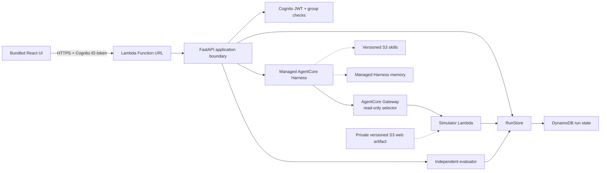
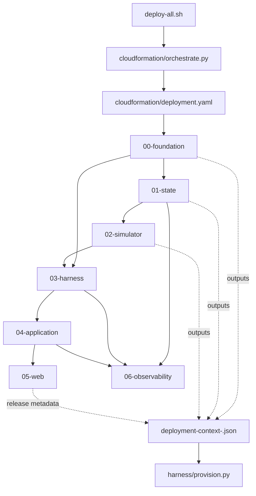
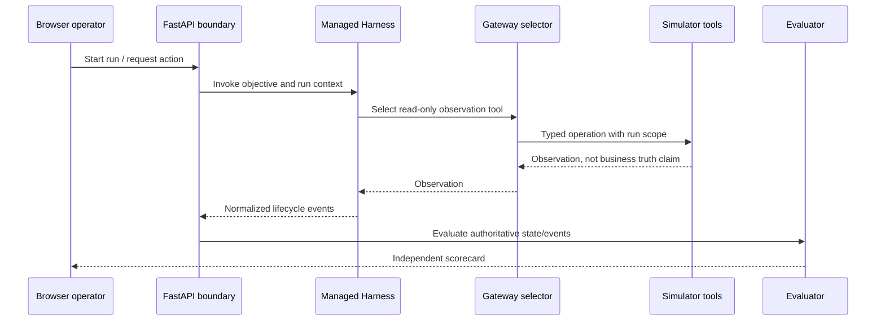

# Northstar Architecture

Northstar is a synthetic IT-operations environment used to exercise managed
AgentCore Harness concepts without exposing real infrastructure. The browser,
API, simulator, Gateway, Harness, state store, and evaluation boundary are
deliberately separate so that model output never becomes operational truth.

## Runtime topology



The UI is bundled into the simulator Lambda package and is served from the
same Function URL as the API. There is no CloudFront distribution, API Gateway
browser endpoint, React CDN, or browser AWS credential. Function URL transport
authentication is `NONE`; the application fails closed with Cognito ID-token
validation for protected routes. The `northstar-admin` Cognito group is
required for user invitation, approval decisions, and other administrative
operations.

## Deployment topology



The deployment pattern is inherited from `agent-poc` but the resources and
handlers are Northstar-specific:

- `deploy-all.sh` is a thin entry point.
- `deployment.yaml` is the stack/dependency source of truth.
- `sam_deploy.py` deploys one target stack and writes its outputs to the
  deployment context.
- Later-stack retries rehydrate predecessor outputs from CloudFormation rather
  than relying on a stale local context file.
- `build-web`, `publish-web`, and the built-in web smoke are allow-listed
  lifecycle steps.
- `05-web` stores the exact release in a private, encrypted, versioned S3
  bucket. It is an artifact record, not the browser endpoint.

## Authority boundaries



The managed selector exposes six read-only operations. Mutations remain in the
direct application API, where the server enforces exact targets, approvals,
expiry, idempotency, optimistic concurrency, and post-action verification.
The `before_tool_call` hook is an additional deny-by-default boundary, not a
replacement for simulator authorization.

## Operational guardrails

- Cognito user-pool self-service creation is disabled with
  `AllowAdminCreateUserOnly: true`.
- Administrative invitation and approval decisions require the
  `northstar-admin` group claim.
- Protected API requests use configurable fixed-window rate limits. The
  current deployment uses 120 general requests/minute and 10 auth-sensitive
  requests/minute per process-local key.
- The simulator has reserved concurrency of 10 and a CloudWatch alarm for more
  than 5,000 invocations in one hour.
- The Gateway execution role is scoped to invoke the named simulator Lambda;
  the unused broad API Gateway invoke grant is not present.
- The Harness role scopes Gateway invocation to the environment's named
  Gateway pattern and skill-package reads to the environment fixture bucket.
- Model invocation is restricted to the configured Nova 2 Lite inference
  profile and its destination foundation-model ARNs; managed-memory events are
  restricted to the environment's `northstar_<environment>_harness-*` memory
  ARN pattern.
- State and web artifact buckets use SSE, versioning, and all four S3 public
  access block settings.
- Lambda logs are retained for 14 days and resources are tagged with the
  Northstar environment.

The request limiter is intentionally a small demo guardrail. It is process-local
and is not a distributed WAF/DDoS control. A production deployment should move
edge enforcement to a distributed service and retain the Lambda limit as a
defense-in-depth control.

## Verification commands

Run local gates from the repository root:

```bash
python3 -m pytest -q
python3 -m pytest -q tests/load tests/unit/test_auth.py tests/unit/test_rate_limit.py
python3 cloudformation/validate.py --skip-cfn-lint
cd apps/web && npm run build
```

Run the bounded hosted checks only with an explicitly supplied URL and
short-lived Cognito ID tokens:

```bash
NORTHSTAR_HOSTED_URL=https://... \\
NORTHSTAR_ID_TOKEN="$ID_TOKEN" \\
NORTHSTAR_OPERATOR_ID_TOKEN="$OPERATOR_ID_TOKEN" \\
python3 -m pytest -q tests/load/test_hosted_api_smoke.py
```

The managed cloud scenario suite uses the same direct Function URL and requires
`NORTHSTAR_ID_TOKEN`; it does not attempt to combine a Cognito bearer token
with API Gateway SigV4:

```bash
NORTHSTAR_ID_TOKEN="$ID_TOKEN" \\
AWS_PROFILE=YOUR_AWS_PROFILE python3 -m harness.smoke_test --scenario-suite \\
  --environment dev --region us-east-1 --profile YOUR_AWS_PROFILE \\
  --model-id us.amazon.nova-2-lite-v1:0
```

Deploy with the inherited pattern:

```bash
AWS_PROFILE=YOUR_AWS_PROFILE AWS_DEFAULT_REGION=us-east-1 \
  ./deploy-all.sh --environment dev --region us-east-1 \
  --resolve-s3 --require-web-smoke
```

A controlled web-only retry uses the same context:

```bash
AWS_PROFILE=YOUR_AWS_PROFILE AWS_DEFAULT_REGION=us-east-1 \
  ./deploy-all.sh --environment dev --region us-east-1 --stack 05-web \
  --context-file cloudformation/build/deployment-context-dev.json \
  --resolve-s3 --require-web-smoke
```

See [`PLAN.md`](../PLAN.md) for phase status and [`TUTORIAL.md`](../TUTORIAL.md)
for the concept-to-proof narrative.
